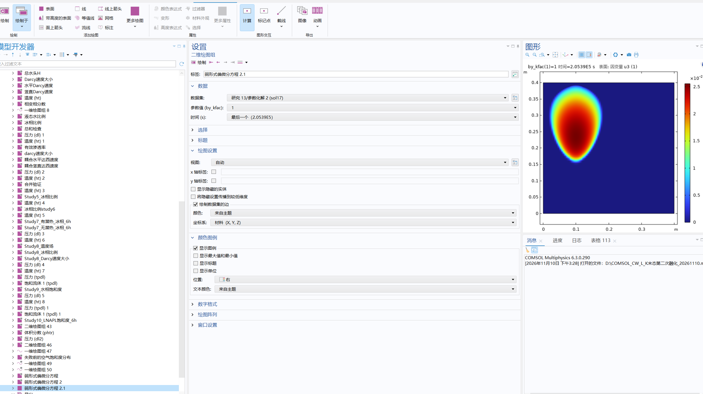

目前最新的模型是CWL，能打开和保存，目前如图

目前模型使用自己定义的弱形式偏微分方程w2,把油、水、气的质量守恒和总焓守恒放在一起求解，再通过温度和相态关系计算结冰、融冰、油的固化和液化。

目前涉及的变量：
| 主变量 | 在模型里代表什么 |
|---|---|
| `u3` | **总油饱和度**，包含液态和固态的十二烷。当前右侧油羽图画的就是它。 |
| `u4` | **水的质量等效饱和度**，用液水密度折算液水和冰的总质量。液水实际占孔隙的比例看 `cl_sw`，冰占孔隙的比例看 `cl_si`。 |
| `u5` | **气相饱和度**。油、液水、冰和气占用的孔隙比例相加应为 1。 |
| `u6` | **缩放后的水压力变量**。查看实际水表压时用 `bc_p`，单位是 Pa。 |
| `u7` | **按参考密度折算的气体质量含量**。气体能压缩，同样的气相饱和度可以对应不同的气体质量。 |
| `u8` | **温度的摄氏数值**，用于计算水冻结和油固化的比例。 |
| `u9` | **缩放后的总焓密度**。导出时乘以 `10⁸ J/m³`，得到包含显热和相变潜热的焓密度。 |

